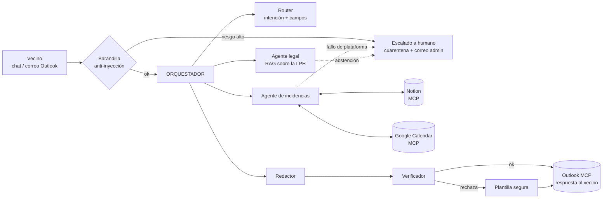

# Conserje IA

**Un conserje digital para comunidades de propietarios.** Los vecinos escriben (por chat o por correo) y
un sistema multi-agente decide qué hacer y lo hace:

- registra la avería en **Notion**;
- cita al técnico en el primer hueco libre de **Google Calendar**;
- responde por **Outlook**;
- resuelve dudas sobre la **Ley de Propiedad Horizontal**, citando el artículo y absteniéndose si no lo sabe.

Todo corre en local con un modelo abierto (**qwen3:8b en Ollama**), sin coste por token.

> Práctica final · Deep Learning para Business Analytics · Comillas ICADE · 2026–2027

---

## 1. Arranque rápido (modo mock: sin cuentas, en cualquier portátil)

**La forma más fácil: doble clic.**

- **Windows:** `INSTALAR_WINDOWS.bat`
- **Mac:** `INSTALAR_MAC.command` (si macOS lo bloquea: clic derecho → Abrir)

El script instala Ollama y Python si faltan, descarga los modelos, prepara el entorno, construye el
índice y abre http://localhost:8000. La primera vez tarda 10-15 min (~6 GB de descarga).

**A mano:**

Requisitos: Python 3.10+ y [Ollama](https://ollama.com/download).

```bash
git clone <este-repo> conserje && cd conserje
python -m venv .venv && source .venv/bin/activate      # Windows: .venv\Scripts\activate
pip install -r requirements.txt

ollama pull qwen3:8b
ollama pull nomic-embed-text

python -m app.rag.indice --construir    # trocea la LPH y calcula embeddings (~30 s)
python -m app                           # -> http://localhost:8000
```

`data/corpus/lph.pdf` ya viene en el repo. Es el texto consolidado de la Ley 49/1960 (BOE-A-1960-10906).
Si falta, descargadlo desde https://www.boe.es/buscar/act.php?id=BOE-A-1960-10906 (botón PDF).

En la web:

1. **Chat** (izquierda): escribid como vecino o usad las sugerencias.
2. **Bandeja**: pulsad *Procesar bandeja con los agentes*. Hay 8 correos de ejemplo: incidencia urgente,
   duplicado, dos dudas legales, un intento de inyección, una consulta de estado, una pregunta fuera de
   tema y una petición de técnico.
3. **Trazas**: cada sesión, paso a paso, con agente, herramienta, permiso, tokens medidos y fallos.
4. Pastillas *Outlook / Calendar / Notion* de la cabecera: **un clic simula la caída** de esa plataforma,
   para ver cómo el sistema escala el caso a un humano.

Sin Ollama la app **también arranca**, en *modo degradado*:

- el router funciona por reglas;
- el RAG pasa a BM25;
- las respuestas legales son un extracto literal citado;
- las respuestas se generan con una plantilla.

La cabecera lo indica en rojo.

**Semillas:** `semilla: 42` en `config.yaml`. Se pasa a Ollama (`options.seed`) y a `random`, con
temperatura 0 en las tareas de clasificación y verificación.

---

## 2. Qué hace el agente que no haría un formulario

| Un formulario… | Conserje IA… |
|---|---|
| obliga al vecino a elegir categoría y urgencia | las **deduce** del texto libre ("sale agua del techo del garaje" → fontanería, prioridad alta) |
| crea un ticket por cada aviso | detecta que es un **duplicado** de una incidencia abierta y no crea otra |
| no sabe de la agenda | lee Google Calendar, **busca el primer hueco libre** (hoy si es urgente) y cita al técnico adecuado |
| no responde dudas legales | contesta con la LPH **citando el artículo**, y **se abstiene** si no hay base |
| ejecuta lo que le pongan | detecta **inyecciones de prompt**, las pone en cuarentena y avisa al administrador |
| se rompe si falla un sistema | si Notion o Calendar caen, responde con lo que sí ha hecho y **escala al humano** |

---

## 3. Arquitectura multi-agente

**Patrón: orquestador con trabajadores + verificador.**



| Agente | Qué hace | Herramientas (permiso) | Contexto que ve | Esfuerzo (`think`) |
|---|---|---|---|---|
| **Orquestador** (código) | Decide el flujo, genera los "hechos", escala y responde | `correo.leer`, `correo.escribir` | **Todo** | — (no es LLM) |
| **Router** | Intención, categoría, prioridad, vivienda, pregunta reformulada | ninguna | Mensaje aislado + nombre | `false` |
| **Legal** | Responde con la LPH, cita y se abstiene | ninguna (sólo el índice RAG) | **Sólo la pregunta** reformulada + fragmentos. No ve quién pregunta | `true` |
| **Incidencias** | Duplicados, ficha técnica, técnico necesario, reserva de hueco | `notion.leer/escribir`, `calendario.leer/escribir` | Salida estructurada del router + mensaje aislado | `false` |
| **Redactor** | Escribe la respuesta | ninguna | Mensaje + lista de hechos | `false` |
| **Verificador** | Comprueba la respuesta antes de enviarla | ninguna | **Sólo** borrador + hechos (no ve la conversación) | `true` |

**Por qué este reparto y no otro.** La alternativa descartada fue un **agente autónomo único** con las
seis herramientas y un bucle ReAct. Con un modelo de 8B en local:

1. elige mal la herramienta y los argumentos más a menudo;
2. una inyección en un correo tendría acceso directo a herramientas de escritura;
3. el coste en tokens no está acotado.

Con el orquestador, el **flujo lo decide el código** y el LLM sólo hace lo que hace bien: clasificar,
interpretar, redactar y juzgar. Las decisiones con consecuencias las toma el código:

- a quién se escribe: siempre el remitente original;
- qué hueco se reserva;
- qué cita legal es válida: sólo las que se recuperaron.

**Qué agentes comparten contexto.** Sólo el orquestador ve todo. El agente legal no recibe datos
personales (minimización, RGPD). El verificador no comparte contexto con el redactor, para que su juicio
sea independiente.

---

## 4. MCP a tres plataformas

| Plataforma | Servidor MCP | Lectura | Escritura | Cuenta de prueba |
|---|---|---|---|---|
| Microsoft Outlook | `@softeria/ms-365-mcp-server` | `correo.leer` → bandeja | `correo.escribir` → respuestas y avisos al admin | `conserje.demo@outlook.com` |
| Google Calendar | `@cocal/google-calendar-mcp` | `calendario.leer` → huecos ocupados | `calendario.escribir` → visita del técnico | `conserje.demo@gmail.com` |
| Notion | `@notionhq/notion-mcp-server` | `notion.leer` → incidencias abiertas | `notion.escribir` → nueva incidencia | base de datos "Incidencias" |

Todas las llamadas pasan por una pasarela única, `app/tools/plataformas.py`, que:

1. comprueba el **permiso** del agente (`config.yaml → permisos`);
2. ejecuta la llamada en el backend `mock` o `mcp`;
3. pasa la **barandilla** por lo que devuelve la herramienta;
4. lo deja en la **traza**.

### Modo MCP (las cuentas reales)

**En Windows hay un asistente de doble clic: `CONECTAR_PLATAFORMAS_WINDOWS.bat`.** Crea el `.env`, la base
de Notion, inicia sesión en Outlook y Google, y comprueba las tres plataformas. A mano:

1. Copiad `.env.example` a `.env` y rellenad los identificadores. `.env` nunca se sube al repo.
2. Notion: cread la base **Incidencias** con estas propiedades y compartidla con la integración:
   - `Nombre` (título)
   - `Categoría` (select)
   - `Prioridad` (select)
   - `Vivienda` (texto)
   - `Estado` (select: Abierta / En curso / Cerrada)
   - `Descripción` (texto)
   - `Fecha` (fecha)
3. Listad las herramientas reales de cada servidor con
   `python -m app.tools.mcp_backend --listar`. Copiad los nombres en `config.yaml → mcp.herramientas` y
   revisad los `TODO` de `app/tools/mcp_backend.py`.
4. Comprobad las lecturas con `python -m app.tools.mcp_backend --probar`.
5. Arrancad con `MODO_PLATAFORMAS=mcp python -m app`.

### Barandillas contra inyección de prompt (`app/guardrails.py`)

1. **Detector** de patrones sobre el mensaje y sobre lo que devuelven las herramientas: ignorar
   instrucciones, cambio de rol, exfiltración, borrado masivo, etiquetas de control y caracteres
   invisibles. Riesgo ≥ 2 → **cuarentena**: ningún agente con permisos lo ve y se escala al humano. Por
   correo no se responde al posible atacante.
2. **Aislamiento:** el texto externo va dentro de `<datos_no_confiables>` y el prompt dice que es dato,
   nunca orden.
3. **Permisos por agente** comprobados en código: si un agente pide algo fuera de su lista, la llamada se
   registra como `denegado`.
4. **Decisiones críticas en código:** el destinatario, las fechas y las citas válidas no las elige el LLM.
5. **Verificador de salida:** citas no respaldadas, datos personales de terceros y fugas del prompt.

### La traza (`logs/trazas.jsonl`, pestaña *Trazas*)

Cada sesión guarda, en orden, cada llamada al LLM y cada llamada a herramienta.

- **Llamada al LLM:** agente, `think`, tokens de entrada y salida **medidos por Ollama**, ms.
- **Llamada a herramienta:** plataforma, permiso (lectura/escritura), estado (`ok` / `error` /
  `denegado`) y argumentos resumidos.
- **Coste de una herramienta:** `tokens_ida` son los tokens de la llamada LLM que la decidió;
  `tokens_vuelta` son los de la llamada LLM en la que entró su resultado.
- **Cuando una falla:** se registra el error y el orquestador responde con lo que sí pudo hacer. Además
  escala a `logs/escalados.jsonl` y envía un correo al administrador.

---

## 5. Modelo, esfuerzo y arnés

| | Elección | Por qué |
|---|---|---|
| **Modelo del producto** | `qwen3:8b` (Alibaba Qwen3, 8B parámetros, cuantizado Q4_K_M) servido con **Ollama** | Gratis y en local. Los datos de los vecinos no salen de la máquina. Buen español. Salida JSON. Razonamiento activable por petición (`think`) |
| **Embeddings** | `nomic-embed-text` (Ollama) | Ligero (274 MB) y multilingüe suficiente. Prefijos `search_query:` / `search_document:` |
| **Esfuerzo por tarea** | `think=false` en router, incidencias y redactor. `think=true` en legal y verificador | Clasificar y redactar no mejoran razonando. Interpretar la ley y juzgar fidelidad sí. El razonamiento multiplica los tokens de salida (ver trazas) |
| **Arnés del producto** | API REST cruda de Ollama (`app/llm.py`, `httpx`) + orquestación propia en Python | Control total del flujo y de los tokens. Sin dependencias de un SDK de agentes |
| **Arnés de construcción** | **Claude Code** con **Claude Opus 5.5** (`claude-opus-5-5`) | Con él se escribió el código. Su usage es el coste de construcción |

### Lo que costó construirlo

`python -m negocio.coste_construccion` lee los ficheros de sesión de Claude Code
(`~/.claude/projects/**/*.jsonl`). Suma `input_tokens`, `output_tokens`, `cache_creation_input_tokens` y
`cache_read_input_tokens` sin duplicar mensajes, y les pone precio con la tarifa de Opus 5.5:
4 $ / 20 $ / 5 $ / 0,20 $ por millón. El resultado va a `logs/coste_construccion.json` y entra en la
inversión inicial del modelo financiero.

Cada miembro lo ejecuta en su portátil y después se suman:

```bash
python -m negocio.coste_construccion --sumar a.json b.json c.json
```

---

## 6. RAG sobre la LPH (bonus)

- **Corpus:** Ley 49/1960 consolidada (BOE). Troceada **por artículo**, con trozos de 1200 caracteres y
  solape de 150. Resultado: 74 trozos, y cada uno conserva su etiqueta `Art. N LPH`.
- **Recuperación híbrida:** fusión de rangos (RRF) entre embeddings y BM25.
- **Cita:** el modelo debe citar `[Art. N LPH]`, y el código borra cualquier cita que no esté entre los
  fragmentos recuperados.
- **Abstención en dos capas:**
  1. similitud del mejor fragmento por debajo de 0,62 → no se llama al modelo;
  2. el modelo devuelve `consta: false` si los fragmentos no responden.

```bash
python -m eval.evaluar_rag            # acierto@3, abstención correcta e indebida, barrido de umbral
python -m eval.evaluar_rag --con-llm  # además, el agente legal completo (cita y abstención finales)
python -m eval.barrido_trozo          # justifica el tamaño de trozo
```

Conjunto anotado en `eval/preguntas.jsonl`: 34 preguntas de vecinos con su artículo correcto y 8 fuera
de dominio. Resultados en `eval/resultados_rag.json` y `eval/barrido_trozo.md`.

---

## 7. Tarea en bucle (bonus)

```bash
python -m app.bucle --cada 300 --vueltas 100 --presupuesto 200000
```

Vigila la bandeja cada 5 minutos y procesa los correos nuevos, como mucho 10 por vuelta. Se para por
cualquiera de estas causas:

- número máximo de vueltas;
- presupuesto de tokens agotado (suma medida);
- 3 vueltas seguidas con error;
- el fichero `STOP` existe;
- Ctrl+C.

Cada vuelta registra su coste en `logs/bucle.jsonl`.

## 8. Análisis de datos dentro del producto (bonus)

La pestaña *Análisis* usa las incidencias de Notion y las trazas.

- **Dato:** avisos por categoría en 90 días.
- **Regla:** si una categoría acumula ≥ 3 avisos en 90 días, se recomienda llevar a la junta un
  mantenimiento preventivo o un contrato.
- **Decisión que cambia:** pasar de pagar reparaciones sueltas a un contrato.

También muestra los tokens y segundos medios por sesión y los escalados por motivo.

## 9. Modelo financiero

```bash
python -m negocio.modelo_financiero
```

- **MEDIDO:** tokens por sesión, sacados de `logs/usage.jsonl`.
- **ESTIMACIÓN:** precio, sesiones por vivienda, GPU, etc., en `negocio/supuestos.yaml`.
- **Salida:** `negocio/salida/modelo_financiero.md` (cada cifra lleva su etiqueta) y el flujo a 36
  meses en `negocio/salida/flujo_36_meses.csv`.
- **Calcula:** coste por comunidad y mes, punto de equilibrio en comunidades y en meses, necesidad de
  caja, ROI a 3 años y el escenario "la GPU sube un 50 %".

**No borréis `logs/usage.jsonl`:** es la fuente de las cifras medidas.

---

## 10. Estructura

```
app/
  main.py            servidor web (FastAPI) y API
  orquestador.py     flujo multi-agente, hechos, escalado, bandeja
  guardrails.py      barandillas anti-inyección y de salida
  llm.py             cliente de Ollama: esfuerzo por tarea, semilla, tokens medidos
  traza.py           trazas de sesión y usage
  agents/            router, legal, incidencias, redactor, verificador
  rag/indice.py      troceado de la LPH, embeddings, BM25, híbrido, abstención
  tools/             pasarela de permisos + backend mock + backend MCP
  bucle.py           tarea en bucle
  static/            web (HTML/CSS/JS sin dependencias externas)
data/                corpus (LPH) y bandeja de ejemplo
eval/                preguntas anotadas y evaluación del RAG
negocio/             supuestos, coste de construcción, modelo financiero
logs/                usage.jsonl, trazas.jsonl, escalados.jsonl (generados)
config.yaml          toda la configuración (modelo, esfuerzo, permisos, MCP, RAG)
```

## 11. Datos personales: qué ve el modelo y adónde viaja

- **Modelo:** corre en local (Ollama). Ningún mensaje sale a un proveedor de IA.
- **Agente legal:** no recibe ni el nombre ni el correo del vecino.
- **Notion:** guarda la vivienda, no el nombre ni el teléfono.
- **Viajan a las plataformas** (Microsoft, Google, Notion) sólo los datos que necesita cada acción, por
  sus servidores MCP y con cuentas de prueba.
- **Secretos:** en `.env`, nunca en el repo.
